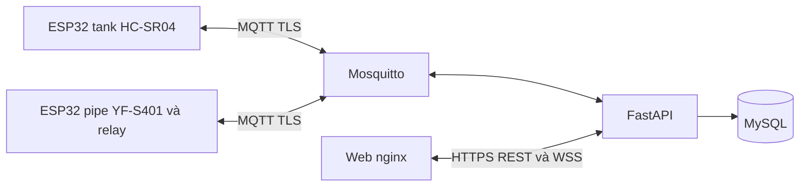

# Kiến trúc và luồng vận hành

Không có lệnh trực tiếp ESP→ESP. Tank gửi mức nước; backend ghép tank/pipe cùng site và kiểm tra mẫu mới trước khi ra lệnh cho pipe. LOW ở TAY mở cảnh báo chờ người bấm Bơm tới đầy. AUTO bật bơm sau đợt thấp hợp lệ; HIGH gửi OFF ở cả hai chế độ. Pipe kiểm TTL/cmd_id, ACK và tự dừng theo bảo vệ cục bộ. ACK xác nhận thực thi lệnh, không tự chứng minh nước đã chảy.

Topic wms/{device_code}/telemetry,status,cmd,ack,config; QoS1. Status/LWT và config retained; cmd không retained. MQTT username và ACL riêng từng node; frontend không giữ MQTT password. device_code trong topic khác khóa số device.id dùng trên REST. boot_id/seq chống trùng; timestamp UTC.

API trả JWT; phân quyền Admin/Operator/Viewer và scope kiểm tại backend. TV3 auth/RBAC/audit được ghép với API/MQTT/CSDL TV2. WebSocket giữ hợp đồng event/data/sent_at của bản đã tích hợp, không dùng giao thức cũ của archive TV3. Xem backend/app/routers và công cụ build_bundle để sinh bảng API từ mã hiện tại.

Bốn container: MySQL3306 nội bộ, backend8000 nội bộ, broker8883 trong container, nginx443 trong container. Hồ sơ hướng dẫn dùng host18883 cho MQTT/TLS và8443 cho HTTPS. Cả hai ESP và laptop cùng hotspot; không cần cloud. Laptop có Internet để cài thư viện/ảnh Docker và ESP đồng bộ giờ NTP; demo đã tải sẵn vẫn cần xử lý NTP hợp lệ trước MQTT/TLS.
